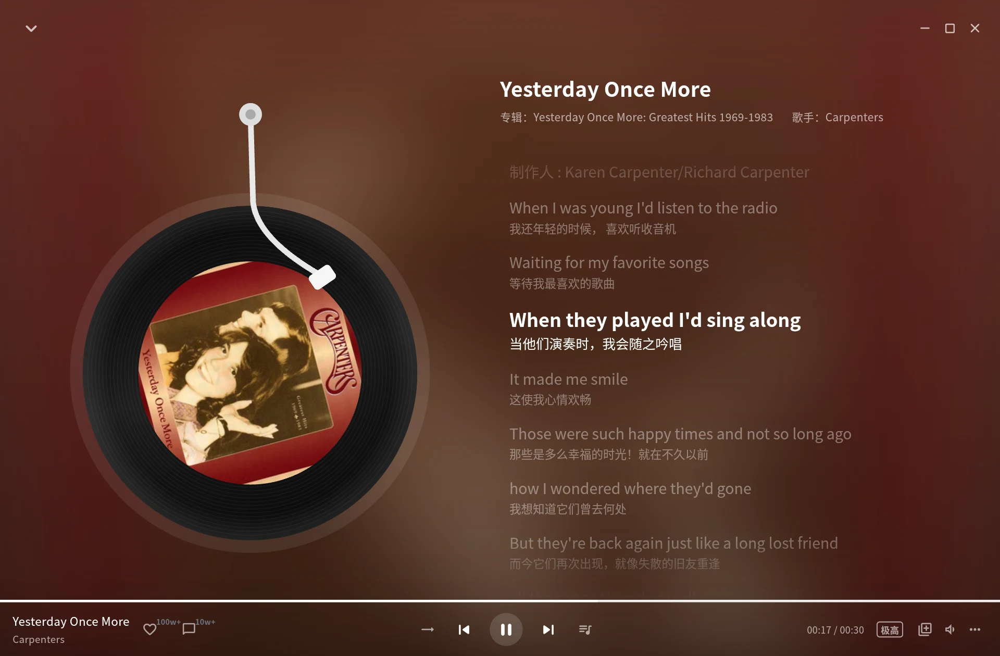
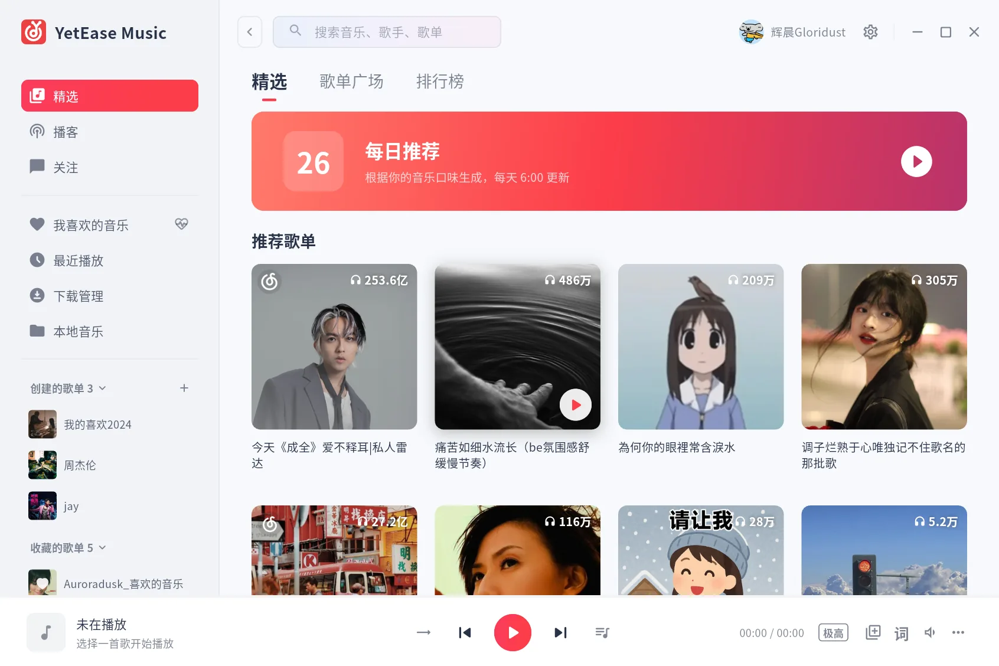
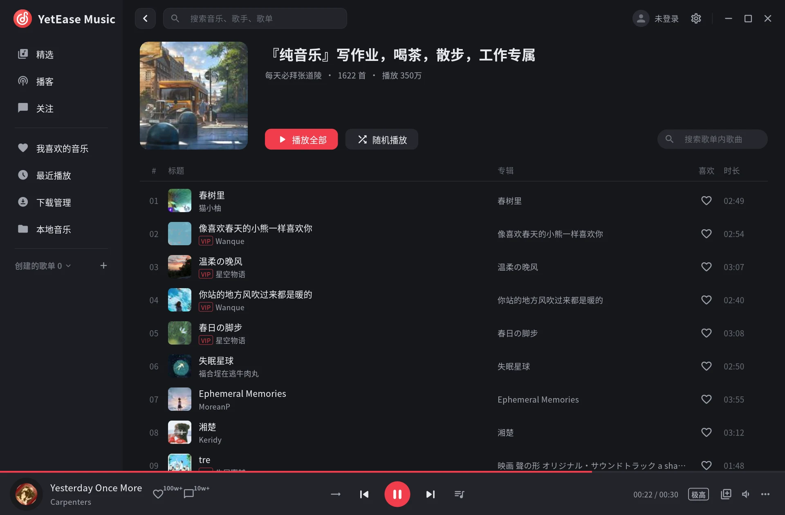
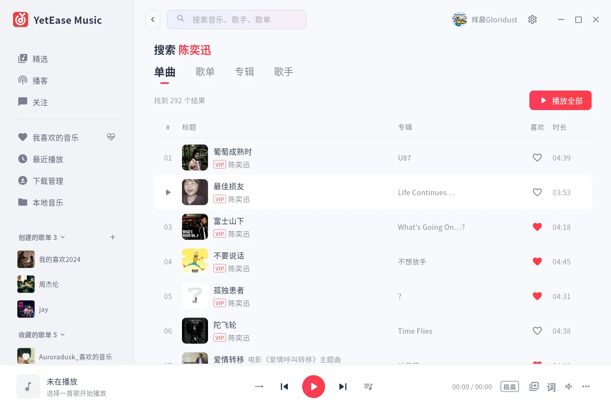
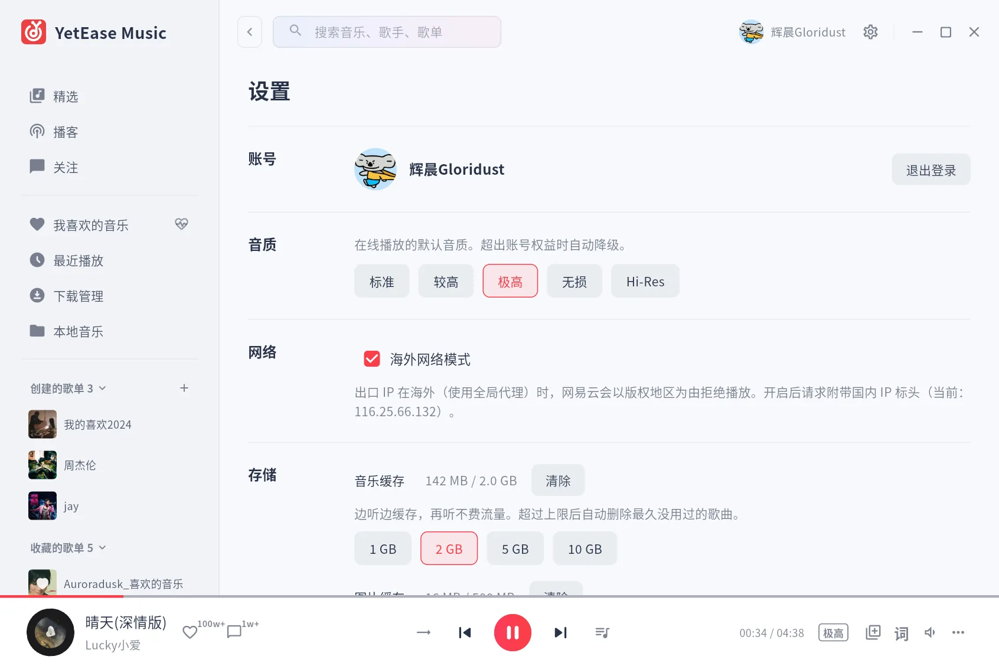

<div align="center">


# YetEase Music

**A fast, clean and good-looking third-party client for NetEase Cloud Music**

Rust native core × Flutter-rendered UI · Built for Linux first, with Windows tablets, Android head units and the terminal in mind

[中文](README.md) · [Architecture](doc/architecture.md) · [Build from source](doc/building.md)




</div>

---

## Why

NetEase has never really cared about these places:

- **Linux** – the official native client stopped at 1.2.1 in 2019 and can no longer stream;
- **Windows tablets** – only a mouse-first desktop app, awkward to use by touch;
- **Android head units** – the phone app stretched onto a wide screen, with tiny buttons and ads;
- **The terminal** – nothing at all.

YetEase fills those gaps: **one core, many front-ends, each feeling native to where it runs.**

## Highlights

### ⚡ Native speed

Decoding, caching, networking and lyric parsing all run in **Rust**. On its own, the playback core stays at about **16 MB** of resident memory. Songs play while they download and become an offline cache once finished, so replays cost no bandwidth.

### 🎨 A native look and feel

The UI is drawn by **Flutter**, following the layout and details of the official Windows and iPad apps:

- the now-playing screen derives its gradient from the album art, the record spins while playing and the tonearm lifts on pause;
- lyrics scroll line by line with translations, and clicking a line seeks to it;
- light / dark themes and adjustable UI scaling, crisp on HiDPI screens.

### 🧩 One core, every platform

Protocol, playback, queue and cache live in a shared Rust core; the UI layer only decides how things look. That means:

- the desktop app and the CLI share the **same** playback engine;
- porting to a new platform means building a UI, not rewriting the logic;
- narrow windows switch to a compact layout, ready for phone and head-unit screens.

### 🔒 Clean

- **Talks to NetEase's official API directly** – no third-party servers in between;
- **No ads**, no promotions, no telemetry;
- your login stays on your own machine.

## Screenshots

<table>
  <tr>
    <td width="50%"></td>
    <td width="50%"></td>
  </tr>
  <tr>
    <td align="center">Recommended playlists</td>
    <td align="center">Playlist · dark mode</td>
  </tr>
  <tr>
    <td width="50%"></td>
    <td width="50%"></td>
  </tr>
  <tr>
    <td align="center">Search</td>
    <td align="center">Settings: quality, overseas mode, theme and scaling</td>
  </tr>
</table>

<p align="center">
  <br>
  <sub>Compact layout for narrow windows</sub>
</p>

## Features

| | Status |
|---|---|
| QR-code login; playlists, likes, daily picks and play history synced with your phone | ✅ |
| Discover / playlist square / charts, podcasts, followed users | ✅ |
| Playlist, album and artist pages; click any artist or album name to jump there | ✅ |
| Search songs / playlists / albums / artists with infinite scrolling | ✅ |
| Like, heartbeat mode, create playlists, add songs to playlists | ✅ |
| Play queue, play next, four play modes | ✅ |
| Stream-while-downloading with a size-capped cache, Standard to Hi-Res quality | ✅ |
| Word-by-word (karaoke) lyrics, translations, click to seek, similar songs | ✅ |
| Desktop lyrics (transparent overlay, word-by-word fill, lockable) | ✅ |
| Song comments (hot + latest) | ✅ |
| Downloads with embedded tags and cover art, local music library | ✅ |
| System media controls: Linux MPRIS (media keys, GNOME panel), Windows SMTC, macOS Now Playing | ✅ |
| System tray; keeps playing after you close the window | ✅ |
| Light / dark theme, UI scaling, overseas mode | ✅ |
| Log export (credentials redacted) for bug reports | ✅ |
| In-app update check, changelog and one-click update (keeps your install method and location) | ✅ |
| CLI and terminal UI (`yetease tui`) | ✅ |
| Save albums, follow artists, save playlists¹ | ✅ |
| Android background playback, notification / lock-screen controls, Bluetooth and steering-wheel keys² | ✅ |

✅ done

¹ Saving a playlist requires NetEase's anti-bot check, which a native client may fail; you'll be told to do it in the mobile app if so. Unsaving always works.
² Built on the Android media session, but not yet tested much on real head units – feedback welcome.

## Platforms

| Platform | Status | Notes |
|---|---|---|
| Linux (x86_64) | ✅ available | Primary target; `.deb`, AppImage and a generic tarball for Ubuntu 22.04 / Debian 12 / Fedora 35 and later |
| CLI / terminal UI | ✅ available | No GUI needed; works on servers and over SSH |
| Windows 10 / 11 (incl. tablets) | ✅ available | Installer and portable zip, built by CI |
| macOS (Intel / Apple silicon) | ✅ available | Universal dmg built by CI; unsigned, so right-click → Open the first time |
| Android / head units | 🧪 beta | Background playback and media keys supported; real head-unit testing in progress |

## Getting started

Grab the package for your platform from **[Releases](https://github.com/Gloridust/YetEaseMusic/releases/latest)**:

| Platform | File |
|---|---|
| Ubuntu / Debian | `yetease-music_<version>_amd64.deb` – double-click, or `sudo apt install ./yetease-music_*.deb` |
| Any Linux (no install) | `yetease-music-<version>-x86_64.AppImage` – make it executable (`chmod +x`, or Properties → Allow executing) and run it |
| Other Linux | `yetease-music-<version>-linux-x86_64.tar.gz` – extract and run `./install.sh` to add it to your app menu |
| Windows | `yetease-music-<version>-windows-x64-setup.exe` (a portable zip is also provided) |
| macOS | `yetease-music-<version>-macos-universal.dmg` |
| Android | `yetease-music-<version>-android-universal.apk` (pick this if unsure about your CPU) |

Once installed, you don't need to come back here: the app checks for new versions at startup (turn it off or check manually under *Settings → About*), then downloads, verifies and updates in place using the same install method – a deb upgrades as a deb, an AppImage is replaced where it is, the tarball install goes back to the same folder, and the Windows installer upgrades silently. macOS downloads and opens the dmg; Android hands the apk to the system installer.

### Flatpak

A community maintainer publishes a Flatpak on [FlatPark](https://flatpark.org/apps/io.github.gloridust.YetEaseMusic/), repackaging this project's official build unmodified, with automatic updates and sandboxing:

```bash
flatpak --user remote-add --if-not-exists flathub https://dl.flathub.org/repo/flathub.flatpakrepo
flatpak --user remote-add --if-not-exists flatpark https://dl.flatpark.org/flatpark.flatpakrepo
flatpak --user install flatpark io.github.gloridust.YetEaseMusic
```

New to Flatpak? On Ubuntu run `sudo apt install flatpak` first; for other distributions see [flatpak.org/setup](https://flatpak.org/setup/).

To build it yourself, see **[doc/building.md](doc/building.md)**.

The CLI (bundled in the .deb, also available separately):

```bash
yetease login                     # QR-code login
yetease tui                       # full-screen terminal UI
yetease search yesterday          # search songs
yetease play yesterday once more  # search and play the first hit
yetease daily --play              # play today's picks
```

## FAQ

**Nothing plays when I'm abroad or behind a global proxy?**
NetEase rejects overseas IPs for licensing reasons. Turn on *Settings → Network → Overseas mode* (on by default).

**Can I play greyed-out (unlicensed) songs?**
No. YetEase only uses audio served by NetEase itself and bundles no third-party sources.

**Desktop lyrics won't stay on top under GNOME?**
GNOME on Wayland doesn't let apps keep their own windows on top. Press Alt+Space on the lyrics window and choose "Always on Top". X11, Windows and macOS keep it on top automatically.

**How do I report a bug?**
*Settings → Feedback → Export logs*, then attach the file to an [issue](https://github.com/Gloridust/YetEaseMusic/issues/new). Login credentials are stripped from exported logs.

**What about VIP songs?**
Log in with a VIP account to play them according to its entitlements; otherwise only previews are available.

## Acknowledgements

- [NeteaseCloudMusicApiEnhanced/api-enhanced](https://github.com/NeteaseCloudMusicApiEnhanced/api-enhanced) – the de-facto protocol reference and this project's main source of truth;
- [Binaryify/NeteaseCloudMusicApi](https://github.com/Binaryify/NeteaseCloudMusicApi) – where it all started;
- [qier222/YesPlayMusic](https://github.com/qier222/YesPlayMusic) – proof that a third-party client can look great;
- [SPlayer-Dev/ncm-api-rs](https://github.com/SPlayer-Dev/ncm-api-rs), [two-mountains/ncmapi-rs](https://github.com/two-mountains/ncmapi-rs) – Rust references;
- [Symphonia](https://github.com/pdeljanov/Symphonia), [cpal](https://github.com/RustAudio/cpal), [flutter_rust_bridge](https://github.com/fzyzcjy/flutter_rust_bridge), [Flutter](https://flutter.dev).

## Disclaimer

YetEase Music is an unofficial third-party client and is not affiliated with NetEase, Inc. or NetEase Cloud Music. It is provided for learning and personal use only. All music content belongs to NetEase Cloud Music and the respective rights holders. Please support the artists.

## License

[MIT](LICENSE)
